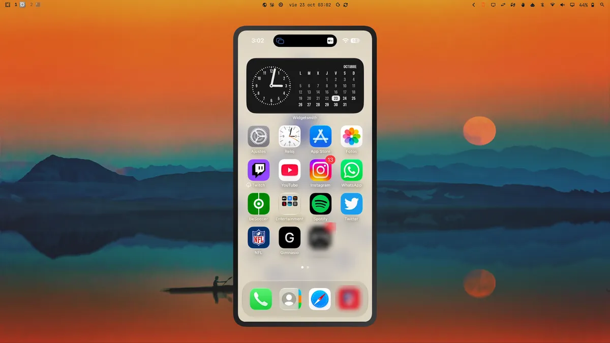

# Portfolio · Rafael Navarro Rosa

Mi portfolio personal: una página en HTML y CSS, sin dependencias, con los
proyectos que mejor muestran lo que sé hacer y el código de cada uno.

**Web:** https://raafaanavrr69.github.io/Portfolio/

## Proyectos que aparecen

| Proyecto | Qué es | Tecnologías |
| --- | --- | --- |
| [iPhone para Omarchy](https://github.com/raafaanavrr69/omarchy-iphone-mirror) | Plugin para la barra de Omarchy que duplica la pantalla del iPhone por AirPlay | QML, Bash |
| [Leyendas Olvidadas](https://github.com/raafaanavrr69/ProyectoPersonaje) | RPG de texto por consola con clases, salas aleatorias y combate por turnos | Java |
| [Prácticas de JavaScript](https://github.com/raafaanavrr69/JavaScript) | Calculadora, generador QR y app del tiempo con OpenWeather | JavaScript |
| [TechSolutions](TechSolutions/) | Portal corporativo con horario, noticias y recursos | HTML, CSS |
| [Bar La Plaza](Carta-bar/) | Carta digital y formulario de pedido a domicilio | HTML, CSS |
| [Estilo Vinilo](https://github.com/raafaanavrr69/Biblioteca-de-musica) | Biblioteca de música con animaciones y Spotify integrado | HTML, CSS |

## Estructura

- `index.html` y `styles.css`: la página principal (con modo oscuro automático).
- `assets/`: capturas de los proyectos, optimizadas en WebP.
- `Carta-bar/` y `TechSolutions/`: demos que se sirven junto al portfolio.

## Verlo en local

Abre `index.html` en el navegador. El formulario de contacto envía los mensajes
con [Formspree](https://formspree.io).
